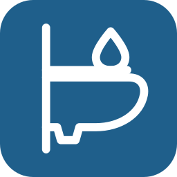

# ioBroker.aquaclean-bridge

[](https://www.npmjs.com/package/iobroker.aquaclean-bridge)
[](https://www.npmjs.com/package/iobroker.aquaclean-bridge)


**Tests:** 

[Deutsche Anleitung](docs/de/README.md)

## AquaClean Bridge adapter for ioBroker

Brings your **Geberit AquaClean shower toilet** into ioBroker through the
[Geberit AquaClean Bridge for ESP](https://github.com/barloew/geberit-aquaclean-bridge-for-esp): a small ESP32-S3
next to the toilet that keeps the toilet's only Bluetooth connection and shares it with your smart home, the
Geberit remote control and the Geberit Home app at the same time.

The adapter talks to the bridge over the **ESPHome native API** — locally, encrypted, without any cloud — and turns
every function of your toilet into a tidy set of ioBroker states: start the shower from a script, show the
descaling countdown in VIS, get a Telegram message when the toilet reports a fault, or switch on the bathroom
light with a long press on the remote control.

> **You need the bridge.** This adapter does not talk to the toilet itself. Build the bridge first (an ESP32-S3
> with at least 8 MB flash, flashed with the **native API** firmware from the
> [web installer](https://barloew.github.io/geberit-aquaclean-bridge-for-esp/)) and save an encryption key on its
> `/setup` page. Supported toilets: AquaClean Sela (validated), Mera, Tuma and Cama (supported through feature
> discovery). The AquaClean 4000 and the Alba are not supported.

## Highlights

- **Your toilet as ioBroker states.** About 300 functions — shower, Lady shower, dryer, orientation light, lid,
  default settings, six user profiles, counters, statistics and maintenance — each as its own state with the
  right **role**, **unit**, **range** and **read/write** flags. VIS widgets, Blockly, the JavaScript adapter,
  scenes, aliases and history/InfluxDB work with them directly.
- **Fixed state IDs, names in your language.** IDs never change: `aquaclean-bridge.0.session.shower_toggle` stays
  the same whichever language your bridge firmware uses. The object names follow your **ioBroker system
  language** (English, German, Russian, Portuguese, Dutch, French, Italian, Spanish, Polish, Ukrainian, Chinese)
  and use Geberit's own terms.
- **Selections as numbers with labels.** Choices such as the light color or the water hardness are number states
  with labels (`common.states`). Your scripts keep working when you change the firmware language; write either
  the number or the label.
- **A clear object tree.** One device per part — `bridge`, `toilet`, `session`, `profile_1` … `profile_6`,
  `maintenance` — with the channels `settings`, `info` and `statistics`. Profile devices show their user's name,
  e.g. *User profile 2 (Anna)*.
- **Only what your toilet has.** The bridge finds out which functions your model offers (feature discovery); the
  adapter creates exactly those states and removes the ones your toilet doesn't offer.
- **Real-time, confirmed.** States are pushed by the bridge the moment they change — no polling. A value you
  write is confirmed (`ack: true`) as soon as the toilet has carried it out. If the toilet refuses (the shower
  only starts while someone is seated), the state returns to the real value after a few seconds and the log says
  why.
- **Remote control buttons as triggers.** Every press on the Geberit remote control — short or long — arrives in
  `session.remote_button`. Use the remote as a bathroom switch for anything in ioBroker.
- **Personal profiles and user recognition.** The bridge recognizes who approaches by their phone, watch or
  tracker and loads their profile. ioBroker sees who is recognized and who is seated (`session.recognized_user`,
  `profile_N.user_recognized`), for example to warm up the bathroom for that person.
- **Alarms and maintenance.** `toilet.toilet_problem` and `bridge.bridge_problem` are ready for notifications;
  days until descaling and filter change, descaling counters and usage statistics are ready for VIS and charts.
- **Physical maintenance, safely gated.** Descaling, arm cleaning and lid calibration appear only after they are
  unlocked at the toilet with the remote control, and disappear again afterwards.
- **Easy setup.** Bridges on your network are found automatically in the instance settings; paste the key, done.
- **Side by side.** The Geberit remote control, one Geberit Home app and Apple Home keep working alongside
  ioBroker.

## Installation

1. **Prepare the bridge.** Flash the **native API** firmware with the
   [web installer](https://barloew.github.io/geberit-aquaclean-bridge-for-esp/), pair the toilet and the remote
   control, and set up your users — see the bridge's
   [installation guide](https://github.com/barloew/geberit-aquaclean-bridge-for-esp#installation).
2. **Save an encryption key.** Open `http://aquaclean-xxxxxx.local/setup` (the last six characters are the end of
   the ESP's MAC address), press **Generate random key**, copy it and press **Save to bridge**.
3. **Install the adapter.** In ioBroker Admin, open **Adapters**, search for **AquaClean Bridge** and install it.
   As long as the adapter is not in the repository yet, install it from GitHub: **Adapters** → the GitHub icon
   (*Install from custom URL*) → `https://github.com/barloew/ioBroker.aquaclean-bridge`.
4. **Configure the instance** (below) and save. The instance turns green once it is connected.

Only one bridge per instance; for a second toilet, add a second instance.

## Configuration

| Setting | Meaning |
|---|---|
| **Bridge (host name or IP address)** | The bridge's address. Bridges found on the network are offered in the list; you can also type e.g. `aquaclean-xxxxxx.local` or an IP address. A fixed IP address (DHCP reservation in your router) is the most reliable. |
| **Port** | `6053`, the native API port. Only change it if you changed it in your own ESPHome YAML. |
| **API encryption key** | The 44-character key from the bridge's `/setup` page (or the `api: encryption: key:` of your own YAML). Stored encrypted. |
| **Also create advanced entities** | Off by default. Adds the discovery and diagnostic tools for other toilet models (raw status, settings scan, arm offsets …), which the bridge itself hides by default. |
| **Remove states of functions the toilet doesn't offer** | On by default. After a rediscovery or a move to another toilet, states that no longer exist are deleted. Physical maintenance is always kept. |

Connect **one** native API client per controller to the bridge: don't let the generic ESPHome adapter connect to
the same bridge at the same time. Every client costs the ESP memory.

## The object tree

```
aquaclean-bridge.0
├── info                 connection, bridge firmware, ESPHome version
├── bridge               the bridge itself (the ESP): connection to the toilet, pairing, recognition threshold,
│   ├── settings         health, memory, Apple Home
│   ├── info
│   └── other            entities the adapter doesn't know (e.g. Restart, time zone)
├── toilet               AquaClean Toilet: orientation light, lid, flush, descaling, fault, counters
│   ├── settings         default settings, light, lid, water hardness …
│   ├── info             model, article and serial number, firmware, signal …
│   └── statistics       usage statistics
├── session              Active session: shower, Lady shower, dryer, current settings, remote control,
│                        recognized and active user, activate/store profile 1–6
├── profile_1 … profile_6  User profiles: recognized, seated, signal
│   ├── settings         the profile's shower settings, user name, welcome light, IRK
│   └── info
└── maintenance          Physical maintenance (only while unlocked)
```

## Working with the states

- **Buttons** (role `button…`) are write-only: write `true` to press them. The state returns to `false` with
  `ack: true` once the command is sent.
- **Switches and levels** are read/write: write the new value with `ack: false`. The bridge answers with the real
  value (`ack: true`).
- **Selections** are numbers with labels. `toilet.settings.light_color = 4` sets the fifth color; writing the label
  in any of the bridge's languages works too.
- **Times** are strings `HH:MM`. **Dates** are milliseconds since 1970 (role `date`).
- **Remote control:** `session.remote_button` holds the id of the last button, e.g. `shower` or `shower_long`. It
  is updated on every press, also for the same button twice in a row: trigger on *any update*, not on *change*.
  Button ids: `shower`, `spray_minus`, `spray_plus`, `arm_back`, `arm_forward`, `lady_shower`, `profile_1`,
  `profile_2`, `profile_3`, `arrow_right`, `arrow_left`, `arrow_down`, `arrow_up`, `oscillation`,
  `orientation_light`, `ok`, `temperature`, `home`, `maintenance`; a long press adds `_long`.

Examples for the JavaScript adapter:

```js
// A long press on the orientation-light key switches the bathroom light
on({ id: 'aquaclean-bridge.0.session.remote_button', change: 'any', ack: true }, obj => {
    if (obj.state.val === 'orientation_light_long') {
        setState('hue.0.Bathroom.on', !getState('hue.0.Bathroom.on').val);
    }
});

// Telegram message when the toilet reports a fault
on({ id: 'aquaclean-bridge.0.toilet.toilet_problem', val: true, ack: true }, () => {
    sendTo('telegram.0', { text: 'AquaClean: ' + getState('aquaclean-bridge.0.toilet.info.last_error_text').val });
});

// Reminder a week before descaling is due
on({ id: 'aquaclean-bridge.0.toilet.days_until_descaling', change: 'ne', ack: true }, obj => {
    if (obj.state.val === 7) sendTo('telegram.0', 'AquaClean: descaling due in one week');
});

// Dimmed warm white orientation light in the evening (color 5 = warm white, brightness 2 of 5)
schedule('0 21 * * *', () => {
    setState('aquaclean-bridge.0.toilet.settings.light_color', 5);
    setState('aquaclean-bridge.0.toilet.settings.light_brightness', 2);
});
```

The shower, Lady shower and dryer only start while someone is seated — the toilet blocks the arms otherwise, so
the bridge refuses the command (and the log says so). Odor extraction and all settings work at any time. Settings
written before sitting down are kept for the next session; that is how a recognized user's profile is loaded in
advance.

## User profiles and recognition

The bridge has up to six user profiles. Profiles 1–3 are the toilet's own (profile keys 1–3 on the remote
control); profiles 4–6 exist only on the bridge and can set the oscillation and water temperature of the Lady
shower separately.

To link a person to a profile, capture the **IRK** (Identity Resolving Key) of their phone, watch or tracker:
press `profile_N.settings.irk_capture` and pair the device with the bridge within two minutes (iPhone: Settings →
Bluetooth → *AquaClean IRK*; Android: first switch on `bridge.settings.irk_android`, then pair *AquaClean
Keyboard*). Or write a known IRK into `profile_N.settings.user_irk_set`. Details are in the bridge's
[Users](https://github.com/barloew/geberit-aquaclean-bridge-for-esp#users) section.

> **An IRK is a credential.** Anyone who has it can recognize and follow the device, whatever address it uses.
> Treat it like a password. The adapter never keeps it: `user_irk_set` is emptied right after writing, and the
> profile only shows the last four digits.

`profile_N.settings.user_ha_device`, `profile_N.info.irk_show` and `bridge.settings.homekit_qr` are for Home Assistant
only; in ioBroker, use an IRK and the `bridge.info.homekit_code` state instead.

## Physical maintenance

Descaling, arm cleaning, spray and lid calibration and the filter change are in the device `maintenance`. It only
exists after it was enabled on the bridge (`maintenance_disclaimer_accepted: "true"` in the bridge's ESPHome YAML)
**and** unlocked at the toilet with a long press of the maintenance key on the remote control. It is hidden again
after 60 minutes, with another long press, with `bridge.settings.maintenance_mode`, or when the bridge restarts.
The adapter keeps these states while the device is hidden, so your VIS views and scripts stay intact.

> **Only use these functions while you are at the toilet yourself, and follow the Geberit operating
> instructions.** Make sure nobody uses the toilet during a procedure. Descaling uses descaling agent; the spray
> arm, dryer arm and lid can move unexpectedly; hot water and hot air can come out. A procedure started from a
> distance cannot be supervised. You use these functions at your own risk — read the full
> [warning](https://github.com/barloew/geberit-aquaclean-bridge-for-esp#physical-maintenance) first.

## Entity reference

All states the bridge creates by default, as they appear below `aquaclean-bridge.0`. Which ones you get depends on
your toilet model and on how the bridge is built (the remote control and Apple Home entities need those parts): functions it doesn't have are left out. The names are those of the English firmware; ioBroker
shows them in your system language. Numbers such as spray intensity, arm position and brightness are levels 1–5,
like on the remote control; a water temperature or seat heating of 0 means off.

<!-- entities:begin -->
### `bridge` — the bridge (the ESP)

| State | Name | Type | Access | Values | What it does |
|---|---|---|---|---|---|
| `bridge.settings.remote_pairing` | Pair remote control | boolean | read/write | true/false | Opens the pairing window for the remote control: then hold + on the remote for about 30 s. |
| `bridge.settings.remote_unpair` | Unpair remote control | boolean | write (button) | true/false | Forgets the paired remote control. |
| `bridge.connected` | Toilet connected | boolean | read | true/false | The bridge is connected to the toilet. |
| `bridge.bridge_health` | Bridge health | number | read | number: 0 = OK, 1 = Degraded, 2 = Recovering, 3 = Needs power-cycle | Overall health of the bridge. |
| `bridge.bridge_problem` | Bridge problem | boolean | read | true/false | The bridge has a problem it cannot solve itself (e.g. it needs a power cycle). |
| `bridge.info.free_heap` | Free memory | number | read | B | Free memory on the ESP. |
| `bridge.info.min_free_heap` | Lowest free memory | number | read | B | Lowest free memory since start. |
| `bridge.info.largest_free_block` | Largest free block | number | read | B | Largest free memory block. |
| `bridge.settings.pair_as_remote` | Pair with toilet | boolean | write (button) | true/false | Pairs the bridge with the toilet (then switch the toilet off for about 30 s and on again). |
| `bridge.settings.irk_android` | Capture IRK as Android keyboard | boolean | read/write | true/false | For Android phones: the bridge offers itself as a keyboard during IRK capture. |
| `bridge.settings.recognition_threshold` | User recognition signal strength | number | read/write | -100–-30 dBm | Signal strength from which a linked device counts as near (default −60 dBm; about −80 dBm for a phone in a pocket). |
| `bridge.settings.maintenance_mode` | Physical maintenance | boolean | read/write | true/false | Shows or hides the Physical maintenance device. Switching on needs the maintenance key on the remote control; see Physical maintenance. |
| `bridge.settings.homekit_enable` | Apple Home | boolean | read/write | true/false | Turns the bridge's Apple Home accessory on or off. |
| `bridge.settings.homekit_qr` | Show HomeKit QR code | boolean | write (button) | true/false | Sends the HomeKit QR code as a Home Assistant notification (Home Assistant only). |
| `bridge.info.homekit_code` | HomeKit code | string | read | text | HomeKit setup code and the link to the bridge's /homekit page with the QR code. |

### `toilet` — AquaClean Toilet

| State | Name | Type | Access | Values | What it does |
|---|---|---|---|---|---|
| `toilet.settings.default_spray_intensity` | Default spray intensity | number | read/write | 1–5 | Spray intensity every new session starts with. |
| `toilet.settings.default_spray_arm_position` | Default spray arm position | number | read/write | 1–5 | Spray arm position every new session starts with. |
| `toilet.settings.default_lady_spray_intensity` | Default spray intensity Lady | number | read/write | 1–5 | Lady shower spray intensity every new session starts with. |
| `toilet.settings.default_lady_spray_arm_position` | Default spray arm position Lady | number | read/write | 1–5 | Lady shower arm position every new session starts with. |
| `toilet.settings.default_water_temperature` | Default water temperature | number | read/write | 0–5 | Water temperature every new session starts with. |
| `toilet.settings.default_oscillating_spray` | Default oscillating spray | boolean | read/write | true/false | Oscillating spray at the start of every session. |
| `toilet.settings.default_seat_heating` | Default seat heating | number | read/write | 0–5 | Seat heating level at the start of every session. |
| `toilet.settings.default_dryer_temperature` | Default dryer temperature | number | read/write | 0–5 | Dryer temperature at the start of every session. |
| `toilet.settings.default_dryer_intensity` | Default dryer intensity | number | read/write | 1–5 | Dryer fan power at the start of every session. |
| `toilet.settings.default_dryer` | Default dryer | boolean | read/write | true/false | Dryer on or off at the start of every session. |
| `toilet.settings.default_odor_extraction` | Default odor extraction | boolean | read/write | true/false | Odor extraction on or off at the start of every session. |
| `toilet.settings.default_seat_heating_on` | Default seat heating on | boolean | read/write | true/false | Seat heating on or off at the start of every session. |
| `toilet.settings.default_preflush` | Default pre-flush | boolean | read/write | true/false | Pre-flush on or off at the start of every session. |
| `toilet.settings.default_wc_water_heating` | Default WC water heating | boolean | read/write | true/false | WC water heating on or off at the start of every session. |
| `toilet.orientation_light` | Orientation light | boolean | read/write | true/false | Orientation light on or off. |
| `toilet.settings.light_activation` | Orientation light activation | number | read/write | number: 0 = Off, 1 = On, 2 = Automatic, 3 = Time-controlled | When the orientation light is on: off, on, automatic (on approach) or time-controlled; models with a light sensor offer “in the dark”. |
| `toilet.settings.light_color` | Orientation light color | number | read/write | number: 0 = Blue, 1 = Turquoise, 2 = Magenta, 3 = Orange, 4 = Yellow, 5 = Warm white, 6 = White | Color of the orientation light (7 colors). |
| `toilet.settings.light_brightness` | Orientation light brightness | number | read/write | 1–5 | Brightness of the orientation light, 1–5. |
| `toilet.settings.light_run_on_time` | Orientation light run-on time | number | read/write | number: 0 = 5 min, 1 = 10 min, 2 = 20 min, 3 = 30 min, 4 = 60 min | How long the orientation light stays on after use. |
| `toilet.settings.light_window_1_start` | Orientation light window 1 start | string | read/write | HH:MM | Start of the first time window (HH:MM) for time-controlled light. |
| `toilet.settings.light_window_1_end` | Orientation light window 1 end | string | read/write | HH:MM | End of the first time window (HH:MM). |
| `toilet.settings.light_window_2_start` | Orientation light window 2 start | string | read/write | HH:MM | Start of the second time window (HH:MM). |
| `toilet.settings.light_window_2_end` | Orientation light window 2 end | string | read/write | HH:MM | End of the second time window (HH:MM). |
| `toilet.settings.demo_mode` | Demo mode | boolean | read/write | true/false | Demo mode of the toilet, as used in showrooms. |
| `toilet.settings.lid_auto_open` | Open lid automatically | boolean | read/write | true/false | The lid opens automatically on approach. |
| `toilet.settings.lid_auto_close` | Close lid automatically | boolean | read/write | true/false | The lid closes automatically after use. |
| `toilet.settings.lid_sensor_range` | Lid sensor range | number | read/write | 1–5 | How far away the lid sensor reacts, 1–5. |
| `toilet.settings.odor_extraction_run_on` | Odor extraction run-on | boolean | read/write | true/false | Odor extraction keeps running for a while after use. |
| `toilet.days_until_descaling` | Next descaling in | number | read | d | Days until the next descaling is due. |
| `toilet.info.showers_until_unlock` | Showers until unlock | number | read |  | Showers left before the shower locks itself until descaling is done. |
| `toilet.info.descaling_requested` | Descaling requested since | number | read | date/time (ms) | Since when the toilet asks for descaling. |
| `toilet.shower_count` | Showers today | number | read |  | Showers today. |
| `toilet.statistics.stat_uptime` | Toilet operating time | number | read | h | Total operating time of the toilet. |
| `toilet.statistics.stat_run_time` | Active operating time | number | read | h | Time the toilet was actively in use. |
| `toilet.statistics.stat_showers` | Showers total | number | read |  | Number of showers since commissioning. |
| `toilet.statistics.stat_lady_showers` | Lady showers total | number | read |  | Number of Lady showers since commissioning. |
| `toilet.statistics.stat_oscillation` | Showers with oscillation | number | read |  | Showers with oscillating spray. |
| `toilet.statistics.stat_lady_oscillation` | Lady showers with oscillation | number | read |  | Lady showers with oscillating spray. |
| `toilet.statistics.stat_dryer` | Dryer uses total | number | read |  | Number of dryer uses. |
| `toilet.statistics.stat_odor` | Odor extraction uses | number | read |  | Number of odor extraction uses. |
| `toilet.statistics.stat_seat_heating` | Seat heating uses | number | read |  | Number of seat heating uses. |
| `toilet.statistics.stat_lid` | Lid lifter uses | number | read |  | Number of lid movements. |
| `toilet.statistics.stat_cleaning` | Cleanings | number | read |  | Number of cleanings. |
| `toilet.statistics.stat_users` | Toilet visits total | number | read |  | Number of toilet visits. |
| `toilet.statistics.stat_system_flush` | System flushes | number | read |  | Number of system flushes. |
| `toilet.statistics.stat_profile_N` | Profile N uses | number | read |  | How often user profile N was used (N is 1–4). |
| `toilet.statistics.stat_last_shower` | Last shower duration | number | read | s | Duration of the last shower. |
| `toilet.statistics.stat_avg_shower` | Average shower duration | number | read | s | Average shower duration. |
| `toilet.statistics.stat_last_lady` | Last lady shower duration | number | read | s | Duration of the last Lady shower. |
| `toilet.statistics.stat_avg_lady` | Average lady shower duration | number | read | s | Average Lady shower duration. |
| `toilet.statistics.stat_last_sitting` | Last toilet visit duration | number | read | s | Duration of the last toilet visit. |
| `toilet.statistics.stat_avg_sitting` | Average toilet visit duration | number | read | s | Average duration of a toilet visit. |
| `toilet.last_descaling` | Last descaling | number | read | date/time (ms) | When the toilet was last descaled. |
| `toilet.descaling_count` | Number of descalings | number | read |  | Number of descalings so far. |
| `toilet.days_until_filter_change` | Days until filter change | number | read | d | Days until the filter needs replacing. |
| `toilet.odor_toggle` | Toggle odor extraction | boolean | write (button) | true/false | Starts or stops odor extraction, at any time (also without anyone seated). |
| `toilet.odor_run_on_toggle` | Toggle odor extraction run-on | boolean | write (button) | true/false | Starts or stops the run-on of the odor extraction. |
| `toilet.info.last_error_text` | Last error | string | read | text | The toilet's last reported error, as text. |
| `toilet.toilet_problem` | Toilet fault | boolean | read | true/false | The toilet reports a fault. Use it for an alarm or a notification. |
| `toilet.info.service_state` | Arm cleaning status | number | read | number: 0 = OK, 1 = Shower arm not cleaned, 2 = Dryer arm not cleaned, 3 = Shower and dryer arm not cleaned | Whether the shower and dryer arms are due for cleaning. |
| `toilet.lid_toggle` | Open or close lid | boolean | write (button) | true/false | Opens or closes the lid. |
| `toilet.settings.auto_flush` | Automatic flush | number | read/write | number: 0 = Off, 1 = On, 2 = Pre-flush | Automatic flush: off, on, or pre-flush. Needs Geberit's interface module. |
| `toilet.settings.light_sensor_sensitivity` | Light sensor sensitivity | number | read/write | 1–5 | How dark it must be before the orientation light reacts, 1–5. |
| `toilet.settings.accessibility_mode` | Accessibility mode | boolean | read/write | true/false | Accessibility mode for users who need more time or support. |
| `toilet.settings.water_hardness` | Water hardness | number | read/write | number: 0 = Soft, 1 = Medium, 2 = Hard | Water hardness at your home; sets the descaling interval. |
| `toilet.info.reconnects` | Reconnections | number | read |  | How often the bridge had to reconnect to the toilet. |
| `toilet.info.connection_uptime` | Connected for | number | read | date/time (ms) | Moment the bridge last connected to the toilet. |
| `toilet.info.model` | Model | string | read | text | Model name, e.g. AquaClean Sela. |
| `toilet.info.firmware` | Firmware | string | read | text | Firmware versions of the toilet. |
| `toilet.info.toilet_signal` | Toilet signal | number | read | dBm | Bluetooth signal strength of the toilet at the bridge (about −60 dBm is ideal). |
| `toilet.info.toilet_address` | Address | string | read | text | Bluetooth address of the toilet. |
| `toilet.info.device_type` | Device type | string | read | text | Device type the toilet reports. |
| `toilet.info.article_number` | Article number | string | read | text | Article number from the type plate. |
| `toilet.info.serial_number` | Serial number | string | read | text | Serial number of the toilet. |
| `toilet.info.production_date` | Production date | string | read | text | Production date of the toilet. |
| `toilet.info.commissioning_date` | Commissioning | string | read | text | Commissioning date of the toilet. |
| `toilet.info.registration` | Registration | number | read | number: 0 = Not registered, 1 = Private, 2 = Public | Registration status of the toilet with Geberit. |
| `toilet.flush` | Flush | boolean | write (button) | true/false | Flushes the toilet. Needs Geberit's interface module (built in on the floor-standing Mera). |

### `session` — Active session

`N` is 1–6.

| State | Name | Type | Access | Values | What it does |
|---|---|---|---|---|---|
| `session.seated` | User detected | boolean | read | true/false | Someone is sitting on the toilet. |
| `session.shower_active` | Shower active | boolean | read | true/false | The shower is running. |
| `session.lady_shower_active` | Lady shower active | boolean | read | true/false | The Lady shower is running. |
| `session.shower_toggle` | Start or stop shower | boolean | write (button) | true/false | Starts the shower, or stops it while it runs. Only while someone is seated. |
| `session.lady_shower_toggle` | Start or stop Lady shower | boolean | write (button) | true/false | Starts the Lady shower, or stops it while it runs. Only while someone is seated. |
| `session.dryer_active` | Dryer running | boolean | read | true/false | The dryer is running. |
| `session.dryer_toggle` | Toggle dryer | boolean | write (button) | true/false | Starts or stops the dryer. Only while someone is seated. |
| `session.stop_all` | Stop shower and dryer | boolean | write (button) | true/false | Stops the shower and the dryer. |
| `session.stop_shower` | Stop shower | boolean | write (button) | true/false | Stops the shower (models without dryer). |
| `session.spray_intensity` | Spray intensity | number | read/write | 1–5 | Spray intensity of the shower in the running session, 1–5 like on the remote control. |
| `session.spray_arm_position` | Spray arm position | number | read/write | 1–5 | Position of the spray arm for the shower, 1–5. |
| `session.lady_spray_intensity` | Spray intensity Lady | number | read/write | 1–5 | Spray intensity of the Lady shower, 1–5. |
| `session.lady_spray_arm_position` | Spray arm position Lady | number | read/write | 1–5 | Position of the spray arm for the Lady shower, 1–5. |
| `session.water_temperature` | Water temperature | number | read/write | 0–5 | Water temperature level; 0 means water heating off. |
| `session.oscillating_spray` | Oscillating spray | boolean | read/write | true/false | Oscillating spray (the spray arm moves back and forth). |
| `session.seat_heating` | Seat heating | number | read/write | 0–5 | Seat heating level; 0 is off. |
| `session.dryer_temperature` | Dryer temperature | number | read/write | 0–5 | Dryer temperature level. |
| `session.dryer_intensity` | Dryer intensity | number | read/write | 1–5 | Dryer fan power. |
| `session.dryer` | Dryer | boolean | read/write | true/false | Dryer on or off in the session settings. |
| `session.odor_extraction` | Odor extraction | boolean | read/write | true/false | Odor extraction on or off in the session settings. |
| `session.seat_heating_on` | Seat heating on | boolean | read/write | true/false | Seat heating on or off. |
| `session.preflush` | Pre-flush | boolean | read/write | true/false | Pre-flush before use on or off. |
| `session.wc_water_heating` | WC water heating | boolean | read/write | true/false | Heating of the WC water on or off. |
| `session.profile_N_activate` | Activate profile N settings | boolean | write (button) | true/false | Loads the settings of user profile N into the session, as if that user was recognized. |
| `session.profile_N_store` | Store settings in profile N | boolean | write (button) | true/false | Stores the current session settings in user profile N. |
| `session.remote_connected` | Remote control connected | boolean | read | true/false | The Geberit remote control is connected through the bridge. |
| `session.remote_button` | Remote control button | string | read | button id, e.g. `shower`, `shower_long` | The last button pressed on the remote control (e.g. shower, shower_long). Updated on every press, also when the same button is pressed again: trigger on any update. |
| `session.app_connected` | Geberit Home app connected | boolean | read | true/false | The Geberit Home app is connected. While it is, the app has priority. |
| `session.recognized_user` | Recognized user | string | read | text | Name of the user the bridge has recognized and whose profile is loaded. |
| `session.active_user` | Active user | string | read | text | Name of the recognized user who is seated. |

### `profile_N` — User profile 1–6

`N` is 1–6. Profiles 1–3 are stored in the toilet (profile keys 1–3 on the remote control), profiles 4–6 only on the bridge.

| State | Name | Type | Access | Values | What it does |
|---|---|---|---|---|---|
| `profile_N.settings.spray_intensity` | Spray intensity | number | read/write | 1–5 | Spray intensity stored in this profile. |
| `profile_N.settings.spray_arm_position` | Spray arm position | number | read/write | 1–5 | Spray arm position stored in this profile. |
| `profile_N.settings.lady_spray_intensity` | Spray intensity Lady | number | read/write | 1–5 | Lady shower spray intensity stored in this profile. |
| `profile_N.settings.lady_spray_arm_position` | Spray arm position Lady | number | read/write | 1–5 | Lady shower arm position stored in this profile. |
| `profile_N.settings.water_temperature` | Water temperature | number | read/write | 0–5 | Water temperature stored in this profile. |
| `profile_N.settings.oscillating_spray` | Oscillating spray | boolean | read/write | true/false | Oscillating spray stored in this profile. |
| `profile_N.settings.seat_heating` | Seat heating | number | read/write | 0–5 | Seat heating level stored in this profile. |
| `profile_N.settings.dryer_temperature` | Dryer temperature | number | read/write | 0–5 | Dryer temperature stored in this profile. |
| `profile_N.settings.dryer_intensity` | Dryer intensity | number | read/write | 1–5 | Dryer fan power stored in this profile. |
| `profile_N.settings.dryer` | Dryer | boolean | read/write | true/false | Dryer on or off in this profile. |
| `profile_N.settings.odor_extraction` | Odor extraction | boolean | read/write | true/false | Odor extraction on or off in this profile. |
| `profile_N.settings.seat_heating_on` | Seat heating on | boolean | read/write | true/false | Seat heating on or off in this profile. |
| `profile_N.settings.preflush` | Pre-flush | boolean | read/write | true/false | Pre-flush on or off in this profile. |
| `profile_N.settings.wc_water_heating` | WC water heating | boolean | read/write | true/false | WC water heating on or off in this profile. |
| `profile_N.settings.delete` | Clear profile | boolean | write (button) | true/false | Clears the profile: name, link, welcome light and IRK; profiles 4–6 also lose their settings. |
| `profile_N.settings.irk_capture` | Capture IRK | boolean | write (button) | true/false | Starts capturing the IRK of a phone, watch or tracker: pair it with the bridge within two minutes. |
| `profile_N.info.irk_show` | Show IRK | boolean | write (button) | true/false | Sends the full IRK as a Home Assistant notification (Home Assistant only). |
| `profile_N.settings.user_name` | User | string | read/write | text | Name of the user of this profile. |
| `profile_N.settings.user_ha_device` | Home Assistant device | string | read/write | text | Home Assistant device tracker linked to this profile (Home Assistant only; leave empty in ioBroker and use an IRK instead). |
| `profile_N.settings.welcome_light` | Welcome light | number | read/write | number: 0 = Off, 1 = Blue, 2 = Turquoise, 3 = Magenta, 4 = Orange, 5 = Yellow, 6 = Warm white, 7 = White | Color in which the orientation light greets this user once recognized; Off for no greeting. |
| `profile_N.user_recognized` | Recognized | boolean | read | true/false | The linked device of this user is near the toilet: the profile is loaded. |
| `profile_N.user_active` | Seated | boolean | read | true/false | This user is recognized and seated (the active user). |
| `profile_N.info.user_rssi` | Device signal user profile N | number | read | dBm | Signal strength of this user's linked device as the bridge hears it. |
| `profile_N.info.user_irk` | IRK | string | read | text | Last four digits of the stored IRK, to check which key is stored. |
| `profile_N.settings.user_irk_set` | Enter IRK | string | write | text | Write a known IRK here (32 hex digits or base64). The field is emptied again right away; an empty value removes the stored IRK. |
| `profile_N.settings.lady_oscillating_spray` | Oscillating spray Lady | boolean | read/write | true/false | Profiles 4–6 only: oscillating spray for the Lady shower, separate from the shower. |
| `profile_N.settings.lady_water_temperature` | Water temperature Lady | number | read/write | 0–5 | Profiles 4–6 only: water temperature for the Lady shower, separate from the shower. |

### `maintenance` — Physical maintenance (only while unlocked)

| State | Name | Type | Access | Values | What it does |
|---|---|---|---|---|---|
| `maintenance.descaling_state` | Descaling status | number | read | number: 0 = Idle, 1 = Preparing, 2 = Waiting for user, 3 = Descaling, 4 = Flushing | Current step of the descaling procedure. |
| `maintenance.descaling_time_left` | Descaling time left | number | read | min | Minutes left in the current descaling step. |
| `maintenance.descaling_start` | Start descaling | boolean | write (button) | true/false | Starts descaling. Only at the toilet, following Geberit's instructions. |
| `maintenance.descaling_continue` | Continue descaling | boolean | write (button) | true/false | Confirms the next descaling step. |
| `maintenance.descaling_cancel` | Cancel descaling | boolean | write (button) | true/false | Cancels the descaling. |
| `maintenance.shower_unlock` | Unlock shower | boolean | write (button) | true/false | Unlocks a shower that is locked because descaling is overdue. |
| `maintenance.filter_reset` | Filter replaced | boolean | write (button) | true/false | Confirms that the filter has been replaced and restarts the countdown. |
| `maintenance.arm_cleaning_start` | Start arm cleaning | boolean | write (button) | true/false | Extends the spray arm for cleaning. |
| `maintenance.arm_cleaning_next` | Arm cleaning next step | boolean | write (button) | true/false | Next step of the arm cleaning. |
| `maintenance.spray_calibration` | Spray calibration | boolean | read | true/false | The spray calibration is running. |
| `maintenance.lid_calibration` | Calibrate lid | boolean | write (button) | true/false | Calibrates the automatic lid. |
| `maintenance.lid_angle_start` | Adjust lid opening angle | boolean | write (button) | true/false | Starts adjusting the lid's opening angle. |
| `maintenance.lid_angle_up` | Lid opening angle larger | boolean | write (button) | true/false | Makes the lid's opening angle larger. |
| `maintenance.lid_angle_down` | Lid opening angle smaller | boolean | write (button) | true/false | Makes the lid's opening angle smaller. |
| `maintenance.lid_angle_save` | Save lid opening angle | boolean | write (button) | true/false | Saves the lid's opening angle. |

#### Advanced entities (option *Also create advanced entities*)

Discovery and diagnostic tools for other models, disabled by default on the bridge: Adjust dryer arm position, Adjust shower arm position, Advertisement, Connected modules, Discovery mode, Drain pump and pipe, Draining, Dryer arm offset, Dryer arm position higher, Dryer arm position lower, Extended trial remaining, Found functions, Last response, Lid offset, Procedures seen, Raw request, Raw status, Read statistics, Rediscover functions, Refresh settings, Remote control address, Remote control firmware, Remote control forward to toilet, Remote control last button, Remote control pass-through to toilet active, Save dryer arm position, Save shower arm position, Scan settings, Search for a nearby toilet, Settings scan, Shower arm offset, Shower arm position higher, Shower arm position lower, Timeouts, Trial period end, Trial period remaining, Without descaling the shower stops in.
<!-- entities:end -->

## Troubleshooting

- **The instance stays yellow/red.** Check the address and that the bridge runs the *native API* firmware (the
  MQTT firmware has no native API). An *Encryption failed* message in the log means the key doesn't match the one
  on the bridge's `/setup` page.
- **A state doesn't change when I write it.** Look at the log: the bridge says why it refused (e.g. nobody
  seated, or the function is not on this toilet). The state returns to the real value after a few seconds.
- **States are missing.** The bridge only offers what your model has. After moving the bridge to another toilet,
  press **Rediscover functions** on the bridge (an advanced entity) or restart it.
- **Different names than expected.** The names follow the ioBroker system language (*System settings*). The
  state IDs never change.
- **Debugging.** Set the instance's log level to *debug* to see every entity the adapter recognized.

## Privacy and security

Everything stays on your network: the adapter talks only to the bridge, encrypted with the native API key. The
key is stored encrypted in the ioBroker configuration. The adapter sends no data anywhere else.

## Disclaimer

This adapter and the AquaClean Bridge are independent, unofficial open-source projects. They are **not**
affiliated with, endorsed, sponsored or supported by **Geberit AG** or any of its group companies. *Geberit*,
*AquaClean* and all related product names are trademarks of Geberit AG and are used only to identify compatible
hardware. Use at your own risk; using unofficial software with your device may affect its manufacturer warranty
and the service terms of your installer.

## Changelog
<!--
    Placeholder for the next version (at the beginning of the line):
    ### **WORK IN PROGRESS**
-->
### 0.1.0 (2026-11-24)

- (barloew) First version: every standard entity of the AquaClean Bridge as an ioBroker state with a fixed id,
  role, unit and names in 11 languages; selections as numbers with labels; remote control button events;
  confirmed commands; bridge search in the instance settings.

## License

MIT License

Copyright (c) 2026 barloew <barloew@users.noreply.github.com>

Permission is hereby granted, free of charge, to any person obtaining a copy
of this software and associated documentation files (the "Software"), to deal
in the Software without restriction, including without limitation the rights
to use, copy, modify, merge, publish, distribute, sublicense, and/or sell
copies of the Software, and to permit persons to whom the Software is
furnished to do so, subject to the following conditions:

The above copyright notice and this permission notice shall be included in all
copies or substantial portions of the Software.

THE SOFTWARE IS PROVIDED "AS IS", WITHOUT WARRANTY OF ANY KIND, EXPRESS OR
IMPLIED, INCLUDING BUT NOT LIMITED TO THE WARRANTIES OF MERCHANTABILITY,
FITNESS FOR A PARTICULAR PURPOSE AND NONINFRINGEMENT. IN NO EVENT SHALL THE
AUTHORS OR COPYRIGHT HOLDERS BE LIABLE FOR ANY CLAIM, DAMAGES OR OTHER
LIABILITY, WHETHER IN AN ACTION OF CONTRACT, TORT OR OTHERWISE, ARISING FROM,
OUT OF OR IN CONNECTION WITH THE SOFTWARE OR THE USE OR OTHER DEALINGS IN THE
SOFTWARE.
