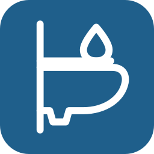

# ioBroker.aquaclean-bridge

[English documentation](../../README.md)

## AquaClean-Bridge-Adapter für ioBroker

Holt Ihr **Geberit AquaClean Dusch-WC** über die
[Geberit AquaClean Bridge for ESP](https://github.com/barloew/geberit-aquaclean-bridge-for-esp) in ioBroker: ein
kleiner ESP32-S3 neben dem WC, der die einzige Bluetooth-Verbindung des WCs hält und sie gleichzeitig mit Ihrem
Smart Home, der Geberit-Fernbedienung und der Geberit Home App teilt.

Der Adapter spricht über die **ESPHome Native API** mit der Bridge — lokal, verschlüsselt, ohne Cloud — und macht
aus jeder Funktion Ihres WCs übersichtliche ioBroker-Datenpunkte: die Dusche per Skript starten, den
Entkalkungs-Countdown in VIS anzeigen, eine Telegram-Nachricht bei einer Störung erhalten oder mit einem langen
Tastendruck auf der Fernbedienung das Badlicht einschalten.

> **Sie brauchen die Bridge.** Dieser Adapter spricht nicht selbst mit dem WC. Bauen Sie zuerst die Bridge auf
> (ein ESP32-S3 mit mindestens 8 MB Flash, mit der **Native-API**-Firmware aus dem
> [Web-Installer](https://barloew.github.io/geberit-aquaclean-bridge-for-esp/) geflasht) und speichern Sie auf
> ihrer `/setup`-Seite einen Verschlüsselungsschlüssel. Unterstützte WCs: AquaClean Sela (validiert), Mera, Tuma
> und Cama (über die Funktionserkennung). AquaClean 4000 und Alba werden nicht unterstützt.

## Highlights

- **Ihr WC als ioBroker-Datenpunkte.** Rund 300 Funktionen — Dusche, Ladydusche, Föhn, Orientierungslicht,
  Deckel, Grundeinstellungen, sechs Benutzerprofile, Zähler, Statistik und Wartung — jeweils als eigener
  Datenpunkt mit passender **Rolle**, **Einheit**, **Wertebereich** und **Lese-/Schreibrechten**. VIS-Widgets,
  Blockly, der JavaScript-Adapter, Szenen, Aliase und History/InfluxDB arbeiten direkt damit.
- **Feste Datenpunkt-IDs, Namen in Ihrer Sprache.** Die IDs ändern sich nie:
  `aquaclean-bridge.0.session.shower_toggle` bleibt gleich, egal in welcher Sprache die Bridge-Firmware läuft.
  Die Objektnamen folgen der **ioBroker-Systemsprache** (Deutsch, Englisch, Russisch, Portugiesisch,
  Niederländisch, Französisch, Italienisch, Spanisch, Polnisch, Ukrainisch, Chinesisch) und verwenden die
  Begriffe von Geberit.
- **Auswahlen als Zahlen mit Beschriftung.** Auswahlen wie Lichtfarbe oder Wasserhärte sind Zahl-Datenpunkte mit
  Beschriftungen (`common.states`). Ihre Skripte funktionieren weiter, wenn Sie die Firmwaresprache wechseln;
  schreiben Sie die Zahl oder die Beschriftung.
- **Ein klarer Objektbaum.** Ein Gerät pro Bereich — `bridge`, `toilet`, `session`, `profile_1` … `profile_6`,
  `maintenance` — mit den Kanälen `settings`, `info` und `statistics`. Profilgeräte zeigen den Namen ihres
  Benutzers, z. B. *Benutzerprofil 2 (Anna)*.
- **Nur was Ihr WC kann.** Die Bridge erkennt, welche Funktionen Ihr Modell hat (Funktionserkennung); der Adapter
  legt genau diese Datenpunkte an und entfernt die, die Ihr WC nicht bietet.
- **Echtzeit, bestätigt.** Die Bridge sendet Änderungen sofort — kein Polling. Ein geschriebener Wert wird
  bestätigt (`ack: true`), sobald das WC ihn ausgeführt hat. Lehnt das WC ab (die Dusche startet nur, wenn jemand
  sitzt), kehrt der Datenpunkt nach einigen Sekunden zum echten Wert zurück, und das Log nennt den Grund.
- **Fernbedienungstasten als Auslöser.** Jeder Tastendruck auf der Geberit-Fernbedienung — kurz oder lang — kommt
  in `session.remote_button` an. Nutzen Sie die Fernbedienung als Badschalter für alles in ioBroker.
- **Persönliche Profile und Benutzererkennung.** Die Bridge erkennt, wer sich nähert, an Telefon, Uhr oder
  Tracker und lädt sein Profil. ioBroker sieht, wer erkannt ist und wer sitzt (`session.recognized_user`,
  `profile_N.user_recognized`), etwa um das Bad für diese Person vorzuheizen.
- **Alarme und Wartung.** `toilet.toilet_problem` und `bridge.bridge_problem` sind bereit für Benachrichtigungen;
  Tage bis zur Entkalkung und zum Filterwechsel, Entkalkungszähler und Nutzungsstatistik sind bereit für VIS und
  Diagramme.
- **Physische Wartung, sicher abgeschirmt.** Entkalkung, Armreinigung und Deckelkalibrierung erscheinen erst,
  nachdem sie am WC mit der Fernbedienung freigeschaltet wurden, und verschwinden danach wieder.
- **Einfache Einrichtung.** Bridges im Netzwerk werden in den Instanzeinstellungen automatisch gefunden; Schlüssel
  einfügen, fertig.
- **Nebeneinander.** Die Geberit-Fernbedienung, eine Geberit Home App und Apple Home funktionieren weiterhin
  neben ioBroker.

## Installation

1. **Bridge vorbereiten.** Die **Native-API**-Firmware mit dem
   [Web-Installer](https://barloew.github.io/geberit-aquaclean-bridge-for-esp/) flashen, WC und Fernbedienung
   koppeln und die Benutzer einrichten — siehe die
   [Installationsanleitung](https://github.com/barloew/geberit-aquaclean-bridge-for-esp#installation) der Bridge.
2. **Verschlüsselungsschlüssel speichern.** `http://aquaclean-xxxxxx.local/setup` öffnen (die letzten sechs
   Zeichen sind das Ende der MAC-Adresse des ESP), **Generate random key** drücken, den Schlüssel kopieren und
   **Save to bridge** drücken.
3. **Adapter installieren.** In ioBroker Admin unter **Adapter** nach **AquaClean Bridge** suchen und
   installieren.
4. **Instanz konfigurieren** (siehe unten) und speichern. Die Instanz wird grün, sobald sie verbunden ist.

Eine Bridge pro Instanz; für ein zweites WC eine zweite Instanz anlegen. Der Adapter benötigt Node.js 22 oder
neuer und js-controller 6.0.11 oder neuer.

## Konfiguration

| Einstellung | Bedeutung |
|---|---|
| **Bridge (Hostname oder IP-Adresse)** | Adresse der Bridge. Im Netzwerk gefundene Bridges werden in der Liste angeboten; Sie können auch z. B. `aquaclean-xxxxxx.local` oder eine IP-Adresse eingeben. Eine feste IP-Adresse (DHCP-Reservierung im Router) ist am zuverlässigsten. |
| **Port** | `6053`, der Port der Native API. Nur ändern, wenn Sie ihn in Ihrem eigenen ESPHome-YAML geändert haben. |
| **API-Verschlüsselungsschlüssel** | Der 44-stellige Schlüssel von der `/setup`-Seite der Bridge (oder `api: encryption: key:` Ihres eigenen YAML). Wird verschlüsselt gespeichert. |
| **Auch erweiterte Entitäten anlegen** | Standardmäßig aus. Fügt die Discovery- und Diagnosewerkzeuge für andere WC-Modelle hinzu (Rohstatus, Einstellungsscan, Arm-Offsets …), die die Bridge selbst standardmäßig ausblendet. |
| **Datenpunkte von Funktionen entfernen, die das WC nicht bietet** | Standardmäßig an. Nach einer erneuten Funktionserkennung oder einem Umzug an ein anderes WC werden Datenpunkte gelöscht, die es nicht mehr gibt. Die physische Wartung bleibt immer erhalten. |

Verbinden Sie pro Steuerung nur **einen** Native-API-Client mit der Bridge: Lassen Sie nicht gleichzeitig den
allgemeinen ESPHome-Adapter mit derselben Bridge verbinden. Jeder Client kostet den ESP Speicher.

## Der Objektbaum

```
aquaclean-bridge.0
├── info                 Verbindung, Bridge-Firmware, ESPHome-Version
├── bridge               die Bridge selbst (der ESP): Verbindung zum WC, Kopplung, Erkennungsschwelle,
│   ├── settings         Zustand, Speicher, Apple Home
│   ├── info
│   └── other            Entitäten, die der Adapter nicht kennt (z. B. Neustart, Zeitzone)
├── toilet               AquaClean WC: Orientierungslicht, Deckel, Spülung, Entkalkung, Störung, Zähler
│   ├── settings         Grundeinstellungen, Licht, Deckel, Wasserhärte …
│   ├── info             Modell, Artikel- und Seriennummer, Firmware, Signal …
│   └── statistics       Nutzungsstatistik
├── session              Aktive Sitzung: Dusche, Ladydusche, Föhn, aktuelle Einstellungen, Fernbedienung,
│                        erkannter und aktiver Benutzer, Profil 1–6 laden/speichern
├── profile_1 … profile_6  Benutzerprofile: erkannt, sitzt, Signal
│   ├── settings         Duscheinstellungen des Profils, Benutzername, Begrüßungslicht, IRK
│   └── info
└── maintenance          Physische Wartung (nur solange freigeschaltet)
```

## Mit den Datenpunkten arbeiten

- **Taster** (Rolle `button…`) sind nur schreibbar: `true` schreiben, um sie zu drücken. Der Datenpunkt kehrt mit
  `ack: true` auf `false` zurück, sobald der Befehl gesendet ist.
- **Schalter und Stufen** sind lesbar und schreibbar: den neuen Wert mit `ack: false` schreiben. Die Bridge
  antwortet mit dem echten Wert (`ack: true`).
- **Auswahlen** sind Zahlen mit Beschriftung. `toilet.settings.light_color = 4` stellt die fünfte Farbe ein; die
  Beschriftung in einer der Sprachen der Bridge zu schreiben funktioniert ebenfalls.
- **Uhrzeiten** sind Texte `HH:MM`. **Zeitpunkte** sind Millisekunden seit 1970 (Rolle `date`).
- **Fernbedienung:** `session.remote_button` enthält die ID der zuletzt gedrückten Taste, z. B. `shower` oder
  `shower_long`. Der Datenpunkt wird bei jedem Druck aktualisiert, auch bei zweimal derselben Taste: auf *jede
  Aktualisierung* triggern, nicht auf *Änderung*. Tasten-IDs: `shower`, `spray_minus`, `spray_plus`, `arm_back`,
  `arm_forward`, `lady_shower`, `profile_1`, `profile_2`, `profile_3`, `arrow_right`, `arrow_left`, `arrow_down`,
  `arrow_up`, `oscillation`, `orientation_light`, `ok`, `temperature`, `home`, `maintenance`; ein langer Druck
  hängt `_long` an.

Beispiele für den JavaScript-Adapter:

```js
// Langer Druck auf die Orientierungslicht-Taste schaltet das Badlicht
on({ id: 'aquaclean-bridge.0.session.remote_button', change: 'any', ack: true }, obj => {
    if (obj.state.val === 'orientation_light_long') {
        setState('hue.0.Bad.on', !getState('hue.0.Bad.on').val);
    }
});

// Telegram-Nachricht, wenn das WC eine Störung meldet
on({ id: 'aquaclean-bridge.0.toilet.toilet_problem', val: true, ack: true }, () => {
    sendTo('telegram.0', { text: 'AquaClean: ' + getState('aquaclean-bridge.0.toilet.info.last_error_text').val });
});

// Erinnerung eine Woche vor der fälligen Entkalkung
on({ id: 'aquaclean-bridge.0.toilet.days_until_descaling', change: 'ne', ack: true }, obj => {
    if (obj.state.val === 7) sendTo('telegram.0', 'AquaClean: Entkalkung in einer Woche fällig');
});

// Abends gedimmtes warmweißes Orientierungslicht (Farbe 5 = Warmweiß, Helligkeit 2 von 5)
schedule('0 21 * * *', () => {
    setState('aquaclean-bridge.0.toilet.settings.light_color', 5);
    setState('aquaclean-bridge.0.toilet.settings.light_brightness', 2);
});
```

Dusche, Ladydusche und Föhn starten nur, wenn jemand sitzt — sonst sperrt das WC die Arme, daher lehnt die Bridge
den Befehl ab (und das Log sagt es). Geruchsabsaugung und alle Einstellungen funktionieren jederzeit.
Einstellungen, die vor dem Hinsetzen geschrieben werden, bleiben für die nächste Sitzung erhalten; so wird das
Profil eines erkannten Benutzers im Voraus geladen.

## Benutzerprofile und Erkennung

Die Bridge hat bis zu sechs Benutzerprofile. Die Profile 1–3 sind die des WCs selbst (Profiltasten 1–3 der
Fernbedienung); die Profile 4–6 gibt es nur in der Bridge, und sie können Oszillation und Wassertemperatur der
Ladydusche getrennt einstellen.

Um eine Person mit einem Profil zu verknüpfen, erfassen Sie den **IRK** (Identity Resolving Key) ihres Telefons,
ihrer Uhr oder ihres Trackers: `profile_N.settings.irk_capture` drücken und das Gerät innerhalb von zwei Minuten
mit der Bridge koppeln (iPhone: Einstellungen → Bluetooth → *AquaClean IRK*; Android: zuerst
`bridge.settings.irk_android` einschalten, dann *AquaClean Keyboard* koppeln). Oder einen bekannten IRK in
`profile_N.settings.user_irk_set` schreiben. Einzelheiten stehen im Abschnitt
[Users](https://github.com/barloew/geberit-aquaclean-bridge-for-esp#users) der Bridge.

> **Ein IRK ist ein Zugangsschlüssel.** Wer ihn hat, kann das Gerät erkennen und verfolgen, egal welche Adresse
> es verwendet. Behandeln Sie ihn wie ein Passwort. Der Adapter speichert ihn nie: `user_irk_set` wird direkt
> nach dem Schreiben geleert, und das Profil zeigt nur die letzten vier Stellen.

`profile_N.settings.user_ha_device`, `profile_N.info.irk_show` und `bridge.settings.homekit_qr` sind nur für Home
Assistant gedacht; verwenden Sie in ioBroker stattdessen einen IRK und den Datenpunkt `bridge.info.homekit_code`.

## Physische Wartung

Entkalkung, Armreinigung, Strahl- und Deckelkalibrierung und der Filterwechsel liegen im Gerät `maintenance`. Es
gibt es erst, nachdem es auf der Bridge aktiviert wurde (`maintenance_disclaimer_accepted: "true"` im
ESPHome-YAML der Bridge) **und** am WC mit einem langen Druck auf die Wartungstaste der Fernbedienung
freigeschaltet wurde. Es wird nach 60 Minuten wieder ausgeblendet, mit einem weiteren langen Druck, mit
`bridge.settings.maintenance_mode` oder beim Neustart der Bridge. Der Adapter behält diese Datenpunkte, solange
das Gerät ausgeblendet ist, damit Ihre VIS-Ansichten und Skripte erhalten bleiben.

> **Verwenden Sie diese Funktionen nur, wenn Sie selbst am WC sind, und befolgen Sie die Bedienungsanleitung von
> Geberit.** Stellen Sie sicher, dass niemand das WC während eines Vorgangs benutzt. Die Entkalkung verwendet
> Entkalkungsmittel; Duscharm, Föhnarm und Deckel können sich unerwartet bewegen; heißes Wasser und heiße Luft
> können austreten. Ein aus der Ferne gestarteter Vorgang kann nicht beaufsichtigt werden. Sie verwenden diese
> Funktionen auf eigenes Risiko — lesen Sie vorher die vollständige
> [Warnung](https://github.com/barloew/geberit-aquaclean-bridge-for-esp#physical-maintenance).

## Datenpunkt-Referenz

Alle Datenpunkte, die die Bridge standardmäßig anlegt, wie sie unter `aquaclean-bridge.0` erscheinen. Welche Sie
erhalten, hängt von Ihrem WC-Modell ab und davon, wie die Bridge gebaut ist (die Entitäten für Fernbedienung und Apple Home brauchen diese Teile): Funktionen, die es nicht hat, fehlen. Die Namen sind die der deutschen
Firmware; ioBroker zeigt sie in Ihrer Systemsprache. Zahlen wie Strahlstärke, Armposition und Helligkeit sind
Stufen 1–5 wie auf der Fernbedienung; eine Wassertemperatur oder Sitzheizung von 0 heißt aus.

<!-- entities:begin -->
### `bridge` — die Bridge (der ESP)

| Datenpunkt | Name | Typ | Zugriff | Werte | Funktion |
|---|---|---|---|---|---|
| `bridge.settings.remote_pairing` | Fernbedienung koppeln | boolean | lesen/schreiben | true/false | Öffnet das Kopplungsfenster für die Fernbedienung: danach + auf der Fernbedienung etwa 30 s gedrückt halten. |
| `bridge.settings.remote_unpair` | Fernbedienung entkoppeln | boolean | schreiben (Taster) | true/false | Vergisst die gekoppelte Fernbedienung. |
| `bridge.connected` | WC verbunden | boolean | lesen | true/false | Die Bridge ist mit dem WC verbunden. |
| `bridge.bridge_health` | Bridge-Status | number | lesen | Zahl: 0 = OK, 1 = Beeinträchtigt, 2 = Erholt sich, 3 = Aus- und Einschalten erforderlich | Allgemeiner Zustand der Bridge. |
| `bridge.bridge_problem` | Bridge-Problem | boolean | lesen | true/false | Die Bridge hat ein Problem, das sie nicht selbst lösen kann (z. B. Neustart durch Stromunterbrechung nötig). |
| `bridge.info.free_heap` | Freier Speicher | number | lesen | B | Freier Speicher auf dem ESP. |
| `bridge.info.min_free_heap` | Niedrigster freier Speicher | number | lesen | B | Niedrigster freier Speicher seit dem Start. |
| `bridge.info.largest_free_block` | Größter freier Block | number | lesen | B | Größter freier Speicherblock. |
| `bridge.settings.pair_as_remote` | Mit WC koppeln | boolean | schreiben (Taster) | true/false | Koppelt die Bridge mit dem WC (danach das WC etwa 30 s ausschalten und wieder einschalten). |
| `bridge.settings.irk_android` | IRK als Android-Tastatur erfassen | boolean | lesen/schreiben | true/false | Für Android-Telefone: Die Bridge meldet sich beim IRK-Erfassen als Tastatur. |
| `bridge.settings.recognition_threshold` | Signalstärke Benutzererkennung | number | lesen/schreiben | -100–-30 dBm | Signalstärke, ab der ein verknüpftes Gerät als nah gilt (Standard −60 dBm; etwa −80 dBm für ein Telefon in der Tasche). |
| `bridge.settings.maintenance_mode` | Physische Wartung | boolean | lesen/schreiben | true/false | Blendet das Gerät Physische Wartung ein oder aus. Zum Einschalten ist die Wartungstaste der Fernbedienung nötig; siehe Physische Wartung. |
| `bridge.settings.homekit_enable` | Apple Home | boolean | lesen/schreiben | true/false | Schaltet das Apple-Home-Zubehör der Bridge ein oder aus. |
| `bridge.settings.homekit_qr` | HomeKit-QR-Code anzeigen | boolean | schreiben (Taster) | true/false | Sendet den HomeKit-QR-Code als Home-Assistant-Benachrichtigung (nur Home Assistant). |
| `bridge.info.homekit_code` | HomeKit-Code | string | lesen | Text | HomeKit-Einrichtungscode und Link zur /homekit-Seite der Bridge mit dem QR-Code. |

### `toilet` — AquaClean WC

| Datenpunkt | Name | Typ | Zugriff | Werte | Funktion |
|---|---|---|---|---|---|
| `toilet.settings.default_spray_intensity` | Standard Duschstrahlstärke | number | lesen/schreiben | 1–5 | Strahlstärke, mit der jede neue Sitzung beginnt. |
| `toilet.settings.default_spray_arm_position` | Standard Duscharmposition | number | lesen/schreiben | 1–5 | Duscharmposition, mit der jede neue Sitzung beginnt. |
| `toilet.settings.default_lady_spray_intensity` | Standard Duschstrahlstärke Lady | number | lesen/schreiben | 1–5 | Strahlstärke der Ladydusche zu Beginn jeder Sitzung. |
| `toilet.settings.default_lady_spray_arm_position` | Standard Duscharmposition Lady | number | lesen/schreiben | 1–5 | Duscharmposition der Ladydusche zu Beginn jeder Sitzung. |
| `toilet.settings.default_water_temperature` | Standard Wassertemperatur | number | lesen/schreiben | 0–5 | Wassertemperatur zu Beginn jeder Sitzung. |
| `toilet.settings.default_oscillating_spray` | Standard Oszillierdusche | boolean | lesen/schreiben | true/false | Oszillierender Strahl zu Beginn jeder Sitzung. |
| `toilet.settings.default_seat_heating` | Standard WC-Sitzheizung | number | lesen/schreiben | 0–5 | Sitzheizungsstufe zu Beginn jeder Sitzung. |
| `toilet.settings.default_dryer_temperature` | Standard Föhntemperatur | number | lesen/schreiben | 0–5 | Föhntemperatur zu Beginn jeder Sitzung. |
| `toilet.settings.default_dryer_intensity` | Standard Föhnintensität | number | lesen/schreiben | 1–5 | Gebläsestärke des Föhns zu Beginn jeder Sitzung. |
| `toilet.settings.default_dryer` | Standard Warmluftföhn | boolean | lesen/schreiben | true/false | Föhn ein oder aus zu Beginn jeder Sitzung. |
| `toilet.settings.default_odor_extraction` | Standard Geruchsabsaugung | boolean | lesen/schreiben | true/false | Geruchsabsaugung ein oder aus zu Beginn jeder Sitzung. |
| `toilet.settings.default_seat_heating_on` | Standard Sitzheizung ein | boolean | lesen/schreiben | true/false | Sitzheizung ein oder aus zu Beginn jeder Sitzung. |
| `toilet.settings.default_preflush` | Standard Vorspülung | boolean | lesen/schreiben | true/false | Vorspülung ein oder aus zu Beginn jeder Sitzung. |
| `toilet.settings.default_wc_water_heating` | Standard WC-Wasserheizung | boolean | lesen/schreiben | true/false | WC-Wassererwärmung ein oder aus zu Beginn jeder Sitzung. |
| `toilet.orientation_light` | Orientierungslicht | boolean | lesen/schreiben | true/false | Orientierungslicht ein oder aus. |
| `toilet.settings.light_activation` | Orientierungslicht Aktivierung | number | lesen/schreiben | Zahl: 0 = Aus, 1 = Ein, 2 = Automatisch, 3 = Zeitgesteuert | Wann das Orientierungslicht leuchtet: aus, ein, automatisch (bei Annäherung) oder zeitgesteuert; Modelle mit Lichtsensor bieten „bei Dunkelheit“. |
| `toilet.settings.light_color` | Orientierungslicht Farbe | number | lesen/schreiben | Zahl: 0 = Blau, 1 = Türkis, 2 = Magenta, 3 = Orange, 4 = Gelb, 5 = Warmweiss, 6 = Weiss | Farbe des Orientierungslichts (7 Farben). |
| `toilet.settings.light_brightness` | Orientierungslicht Helligkeit | number | lesen/schreiben | 1–5 | Helligkeit des Orientierungslichts, 1–5. |
| `toilet.settings.light_run_on_time` | Orientierungslicht Nachlaufzeit | number | lesen/schreiben | Zahl: 0 = 5 min, 1 = 10 min, 2 = 20 min, 3 = 30 min, 4 = 60 min | Wie lange das Orientierungslicht nach der Benutzung nachleuchtet. |
| `toilet.settings.light_window_1_start` | Orientierungslicht Zeitfenster 1 Beginn | string | lesen/schreiben | HH:MM | Beginn des ersten Zeitfensters (HH:MM) für das zeitgesteuerte Licht. |
| `toilet.settings.light_window_1_end` | Orientierungslicht Zeitfenster 1 Ende | string | lesen/schreiben | HH:MM | Ende des ersten Zeitfensters (HH:MM). |
| `toilet.settings.light_window_2_start` | Orientierungslicht Zeitfenster 2 Beginn | string | lesen/schreiben | HH:MM | Beginn des zweiten Zeitfensters (HH:MM). |
| `toilet.settings.light_window_2_end` | Orientierungslicht Zeitfenster 2 Ende | string | lesen/schreiben | HH:MM | Ende des zweiten Zeitfensters (HH:MM). |
| `toilet.settings.demo_mode` | Demomodus | boolean | lesen/schreiben | true/false | Demomodus des WCs, wie er in Ausstellungen verwendet wird. |
| `toilet.settings.lid_auto_open` | Deckel automatisch öffnen | boolean | lesen/schreiben | true/false | Der Deckel öffnet sich bei Annäherung automatisch. |
| `toilet.settings.lid_auto_close` | Deckel automatisch schließen | boolean | lesen/schreiben | true/false | Der Deckel schließt sich nach der Benutzung automatisch. |
| `toilet.settings.lid_sensor_range` | Reichweite Deckelsensor | number | lesen/schreiben | 1–5 | Aus welcher Entfernung der Deckelsensor reagiert, 1–5. |
| `toilet.settings.odor_extraction_run_on` | Nachlauf Geruchsabsaugung | boolean | lesen/schreiben | true/false | Die Geruchsabsaugung läuft nach der Benutzung eine Weile nach. |
| `toilet.days_until_descaling` | Nächste Entkalkung in | number | lesen | d | Tage bis zur nächsten fälligen Entkalkung. |
| `toilet.info.showers_until_unlock` | Duschgänge bis Entsperrung | number | lesen |  | Verbleibende Duschgänge, bevor sich die Dusche bis zur Entkalkung sperrt. |
| `toilet.info.descaling_requested` | Entkalkung angefordert seit | number | lesen | Datum/Uhrzeit (ms) | Seit wann das WC eine Entkalkung anfordert. |
| `toilet.shower_count` | Duschvorgänge heute | number | lesen |  | Duschgänge heute. |
| `toilet.statistics.stat_uptime` | Betriebszeit WC | number | lesen | h | Gesamtbetriebszeit des WCs. |
| `toilet.statistics.stat_run_time` | Betriebszeit aktiv | number | lesen | h | Zeit, in der das WC aktiv benutzt wurde. |
| `toilet.statistics.stat_showers` | Duschvorgänge gesamt | number | lesen |  | Anzahl Duschgänge seit Inbetriebnahme. |
| `toilet.statistics.stat_lady_showers` | Ladydusche-Vorgänge gesamt | number | lesen |  | Anzahl Ladyduschen seit Inbetriebnahme. |
| `toilet.statistics.stat_oscillation` | Duschvorgänge mit Oszillation | number | lesen |  | Duschgänge mit oszillierendem Strahl. |
| `toilet.statistics.stat_lady_oscillation` | Ladydusche-Vorgänge mit Oszillation | number | lesen |  | Ladyduschen mit oszillierendem Strahl. |
| `toilet.statistics.stat_dryer` | Föhnvorgänge gesamt | number | lesen |  | Anzahl Föhnbenutzungen. |
| `toilet.statistics.stat_odor` | Geruchsabsaugung genutzt | number | lesen |  | Anzahl Benutzungen der Geruchsabsaugung. |
| `toilet.statistics.stat_seat_heating` | Sitzheizung genutzt | number | lesen |  | Anzahl Benutzungen der Sitzheizung. |
| `toilet.statistics.stat_lid` | Deckelöffner genutzt | number | lesen |  | Anzahl Deckelbewegungen. |
| `toilet.statistics.stat_cleaning` | Reinigungen | number | lesen |  | Anzahl Reinigungen. |
| `toilet.statistics.stat_users` | WC-Besuche gesamt | number | lesen |  | Anzahl WC-Besuche. |
| `toilet.statistics.stat_system_flush` | Systemspülungen | number | lesen |  | Anzahl Systemspülungen. |
| `toilet.statistics.stat_profile_N` | Nutzung Profil N | number | lesen |  | Wie oft Benutzerprofil N verwendet wurde (N ist 1–4). |
| `toilet.statistics.stat_last_shower` | Dauer letzte Dusche | number | lesen | s | Dauer des letzten Duschgangs. |
| `toilet.statistics.stat_avg_shower` | Durchschnittliche Duschdauer | number | lesen | s | Durchschnittliche Duschdauer. |
| `toilet.statistics.stat_last_lady` | Dauer letzte Ladydusche | number | lesen | s | Dauer der letzten Ladydusche. |
| `toilet.statistics.stat_avg_lady` | Durchschnittliche Ladydusche-Dauer | number | lesen | s | Durchschnittliche Dauer der Ladydusche. |
| `toilet.statistics.stat_last_sitting` | Dauer letzter WC-Besuch | number | lesen | s | Dauer des letzten WC-Besuchs. |
| `toilet.statistics.stat_avg_sitting` | Durchschnittliche Dauer WC-Besuch | number | lesen | s | Durchschnittliche Dauer eines WC-Besuchs. |
| `toilet.last_descaling` | Letzte Entkalkung | number | lesen | Datum/Uhrzeit (ms) | Wann das WC zuletzt entkalkt wurde. |
| `toilet.descaling_count` | Anzahl Entkalkungen | number | lesen |  | Bisherige Anzahl Entkalkungen. |
| `toilet.days_until_filter_change` | Tage bis Filterwechsel | number | lesen | d | Tage bis zum nächsten Filterwechsel. |
| `toilet.odor_toggle` | Geruchsabsaugung umschalten | boolean | schreiben (Taster) | true/false | Startet oder stoppt die Geruchsabsaugung, jederzeit (auch wenn niemand sitzt). |
| `toilet.odor_run_on_toggle` | Nachlauf Geruchsabsaugung umschalten | boolean | schreiben (Taster) | true/false | Startet oder stoppt den Nachlauf der Geruchsabsaugung. |
| `toilet.info.last_error_text` | Letzter Fehler | string | lesen | Text | Der zuletzt gemeldete Fehler des WCs, als Text. |
| `toilet.toilet_problem` | WC-Störung | boolean | lesen | true/false | Das WC meldet eine Störung. Geeignet für einen Alarm oder eine Benachrichtigung. |
| `toilet.info.service_state` | Reinigungsstatus Arme | number | lesen | Zahl: 0 = OK, 1 = Duscharm nicht gereinigt, 2 = Föhnarm nicht gereinigt, 3 = Dusch- und Föhnarm nicht gereinigt | Ob Dusch- und Föhnarm gereinigt werden müssen. |
| `toilet.lid_toggle` | Deckel öffnen oder schließen | boolean | schreiben (Taster) | true/false | Öffnet oder schließt den Deckel. |
| `toilet.settings.auto_flush` | Automatische Spülung | number | lesen/schreiben | Zahl: 0 = Aus, 1 = Ein, 2 = Vorspülung | Automatische Spülung: aus, ein oder Vorspülung. Benötigt das Geberit-Interface-Modul. |
| `toilet.settings.light_sensor_sensitivity` | Lichtsensor-Empfindlichkeit | number | lesen/schreiben | 1–5 | Wie dunkel es sein muss, bevor das Orientierungslicht reagiert, 1–5. |
| `toilet.settings.accessibility_mode` | Barrierefreier Modus | boolean | lesen/schreiben | true/false | Barrierefreiheitsmodus für Benutzer, die mehr Zeit oder Unterstützung brauchen. |
| `toilet.settings.water_hardness` | Wasserhärte | number | lesen/schreiben | Zahl: 0 = Weich, 1 = Mittel, 2 = Hart | Wasserhärte bei Ihnen zu Hause; bestimmt das Entkalkungsintervall. |
| `toilet.info.reconnects` | Neuverbindungen | number | lesen |  | Wie oft die Bridge sich neu mit dem WC verbinden musste. |
| `toilet.info.connection_uptime` | Verbunden seit | number | lesen | Datum/Uhrzeit (ms) | Zeitpunkt der letzten Verbindung der Bridge mit dem WC. |
| `toilet.info.model` | Modell | string | lesen | Text | Modellname, z. B. AquaClean Sela. |
| `toilet.info.firmware` | Firmware | string | lesen | Text | Firmwareversionen des WCs. |
| `toilet.info.toilet_signal` | WC-Signal | number | lesen | dBm | Bluetooth-Signalstärke des WCs an der Bridge (etwa −60 dBm ist ideal). |
| `toilet.info.toilet_address` | Adresse | string | lesen | Text | Bluetooth-Adresse des WCs. |
| `toilet.info.device_type` | Gerätetyp | string | lesen | Text | Vom WC gemeldeter Gerätetyp. |
| `toilet.info.article_number` | Artikelnummer | string | lesen | Text | Artikelnummer vom Typenschild. |
| `toilet.info.serial_number` | Seriennummer | string | lesen | Text | Seriennummer des WCs. |
| `toilet.info.production_date` | Produktionsdatum | string | lesen | Text | Produktionsdatum des WCs. |
| `toilet.info.commissioning_date` | Inbetriebnahme | string | lesen | Text | Datum der Inbetriebnahme des WCs. |
| `toilet.info.registration` | Registrierung | number | lesen | Zahl: 0 = Nicht registriert, 1 = Privat, 2 = Öffentlich | Registrierungsstatus des WCs bei Geberit. |
| `toilet.flush` | Spülen | boolean | schreiben (Taster) | true/false | Löst die Spülung aus. Benötigt das Geberit-Interface-Modul (beim bodenstehenden Mera eingebaut). |

### `session` — Aktive Sitzung

`N` ist 1–6.

| Datenpunkt | Name | Typ | Zugriff | Werte | Funktion |
|---|---|---|---|---|---|
| `session.seated` | Benutzer erkannt | boolean | lesen | true/false | Jemand sitzt auf dem WC. |
| `session.shower_active` | Dusche aktiv | boolean | lesen | true/false | Die Dusche läuft. |
| `session.lady_shower_active` | Ladydusche aktiv | boolean | lesen | true/false | Die Ladydusche läuft. |
| `session.shower_toggle` | Dusche starten oder stoppen | boolean | schreiben (Taster) | true/false | Startet die Dusche oder stoppt sie, wenn sie läuft. Nur wenn jemand sitzt. |
| `session.lady_shower_toggle` | Ladydusche starten oder stoppen | boolean | schreiben (Taster) | true/false | Startet die Ladydusche oder stoppt sie, wenn sie läuft. Nur wenn jemand sitzt. |
| `session.dryer_active` | Föhn aktiv | boolean | lesen | true/false | Der Föhn läuft. |
| `session.dryer_toggle` | Föhn umschalten | boolean | schreiben (Taster) | true/false | Startet oder stoppt den Föhn. Nur wenn jemand sitzt. |
| `session.stop_all` | Dusche und Föhn stoppen | boolean | schreiben (Taster) | true/false | Stoppt Dusche und Föhn. |
| `session.stop_shower` | Dusche stoppen | boolean | schreiben (Taster) | true/false | Stoppt die Dusche (Modelle ohne Föhn). |
| `session.spray_intensity` | Duschstrahlstärke | number | lesen/schreiben | 1–5 | Strahlstärke der Dusche in der laufenden Sitzung, 1–5 wie auf der Fernbedienung. |
| `session.spray_arm_position` | Duscharmposition | number | lesen/schreiben | 1–5 | Position des Duscharms für die Dusche, 1–5. |
| `session.lady_spray_intensity` | Duschstrahlstärke Lady | number | lesen/schreiben | 1–5 | Strahlstärke der Ladydusche, 1–5. |
| `session.lady_spray_arm_position` | Duscharmposition Lady | number | lesen/schreiben | 1–5 | Position des Duscharms für die Ladydusche, 1–5. |
| `session.water_temperature` | Wassertemperatur | number | lesen/schreiben | 0–5 | Stufe der Wassertemperatur; 0 heißt Wassererwärmung aus. |
| `session.oscillating_spray` | Oszillierdusche | boolean | lesen/schreiben | true/false | Oszillierender Strahl (der Duscharm bewegt sich vor und zurück). |
| `session.seat_heating` | WC-Sitzheizung | number | lesen/schreiben | 0–5 | Stufe der Sitzheizung; 0 ist aus. |
| `session.dryer_temperature` | Föhntemperatur | number | lesen/schreiben | 0–5 | Temperaturstufe des Föhns. |
| `session.dryer_intensity` | Föhnintensität | number | lesen/schreiben | 1–5 | Gebläsestärke des Föhns. |
| `session.dryer` | Warmluftföhn | boolean | lesen/schreiben | true/false | Föhn ein oder aus in den Sitzungseinstellungen. |
| `session.odor_extraction` | Geruchsabsaugung | boolean | lesen/schreiben | true/false | Geruchsabsaugung ein oder aus in den Sitzungseinstellungen. |
| `session.seat_heating_on` | Sitzheizung ein | boolean | lesen/schreiben | true/false | Sitzheizung ein oder aus. |
| `session.preflush` | Vorspülung | boolean | lesen/schreiben | true/false | Vorspülung vor der Benutzung ein oder aus. |
| `session.wc_water_heating` | WC-Wasserheizung | boolean | lesen/schreiben | true/false | Erwärmung des WC-Wassers ein oder aus. |
| `session.profile_N_activate` | Einstellungen von Profil N aktivieren | boolean | schreiben (Taster) | true/false | Lädt die Einstellungen von Benutzerprofil N in die Sitzung, als wäre dieser Benutzer erkannt worden. |
| `session.profile_N_store` | Einstellungen in Profil N speichern | boolean | schreiben (Taster) | true/false | Speichert die aktuellen Sitzungseinstellungen in Benutzerprofil N. |
| `session.remote_connected` | Fernbedienung verbunden | boolean | lesen | true/false | Die Geberit-Fernbedienung ist über die Bridge verbunden. |
| `session.remote_button` | Fernbedienung Taste | string | lesen | Tasten-ID, z. B. `shower`, `shower_long` | Die zuletzt gedrückte Taste der Fernbedienung (z. B. shower, shower_long). Wird bei jedem Druck aktualisiert, auch wenn dieselbe Taste erneut gedrückt wird: auf jede Aktualisierung triggern. |
| `session.app_connected` | Geberit Home App verbunden | boolean | lesen | true/false | Die Geberit Home App ist verbunden. Solange sie verbunden ist, hat sie Vorrang. |
| `session.recognized_user` | Erkannter Benutzer | string | lesen | Text | Name des Benutzers, den die Bridge erkannt und dessen Profil sie geladen hat. |
| `session.active_user` | Aktiver Benutzer | string | lesen | Text | Name des erkannten Benutzers, der sitzt. |

### `profile_N` — Benutzerprofil 1–6

`N` ist 1–6. Die Profile 1–3 sind im WC gespeichert (Profiltasten 1–3 der Fernbedienung), die Profile 4–6 nur in der Bridge.

| Datenpunkt | Name | Typ | Zugriff | Werte | Funktion |
|---|---|---|---|---|---|
| `profile_N.settings.spray_intensity` | Duschstrahlstärke | number | lesen/schreiben | 1–5 | In diesem Profil gespeicherte Strahlstärke. |
| `profile_N.settings.spray_arm_position` | Duscharmposition | number | lesen/schreiben | 1–5 | In diesem Profil gespeicherte Duscharmposition. |
| `profile_N.settings.lady_spray_intensity` | Duschstrahlstärke Lady | number | lesen/schreiben | 1–5 | In diesem Profil gespeicherte Strahlstärke der Ladydusche. |
| `profile_N.settings.lady_spray_arm_position` | Duscharmposition Lady | number | lesen/schreiben | 1–5 | In diesem Profil gespeicherte Duscharmposition der Ladydusche. |
| `profile_N.settings.water_temperature` | Wassertemperatur | number | lesen/schreiben | 0–5 | In diesem Profil gespeicherte Wassertemperatur. |
| `profile_N.settings.oscillating_spray` | Oszillierdusche | boolean | lesen/schreiben | true/false | In diesem Profil gespeicherter oszillierender Strahl. |
| `profile_N.settings.seat_heating` | WC-Sitzheizung | number | lesen/schreiben | 0–5 | In diesem Profil gespeicherte Sitzheizungsstufe. |
| `profile_N.settings.dryer_temperature` | Föhntemperatur | number | lesen/schreiben | 0–5 | In diesem Profil gespeicherte Föhntemperatur. |
| `profile_N.settings.dryer_intensity` | Föhnintensität | number | lesen/schreiben | 1–5 | In diesem Profil gespeicherte Gebläsestärke des Föhns. |
| `profile_N.settings.dryer` | Warmluftföhn | boolean | lesen/schreiben | true/false | Föhn ein oder aus in diesem Profil. |
| `profile_N.settings.odor_extraction` | Geruchsabsaugung | boolean | lesen/schreiben | true/false | Geruchsabsaugung ein oder aus in diesem Profil. |
| `profile_N.settings.seat_heating_on` | Sitzheizung ein | boolean | lesen/schreiben | true/false | Sitzheizung ein oder aus in diesem Profil. |
| `profile_N.settings.preflush` | Vorspülung | boolean | lesen/schreiben | true/false | Vorspülung ein oder aus in diesem Profil. |
| `profile_N.settings.wc_water_heating` | WC-Wasserheizung | boolean | lesen/schreiben | true/false | WC-Wassererwärmung ein oder aus in diesem Profil. |
| `profile_N.settings.delete` | Profil löschen | boolean | schreiben (Taster) | true/false | Leert das Profil: Name, Verknüpfung, Begrüßungslicht und IRK; Profile 4–6 verlieren auch ihre Einstellungen. |
| `profile_N.settings.irk_capture` | IRK erfassen | boolean | schreiben (Taster) | true/false | Startet das Erfassen des IRK eines Telefons, einer Uhr oder eines Trackers: innerhalb von zwei Minuten mit der Bridge koppeln. |
| `profile_N.info.irk_show` | IRK anzeigen | boolean | schreiben (Taster) | true/false | Sendet den vollständigen IRK als Home-Assistant-Benachrichtigung (nur Home Assistant). |
| `profile_N.settings.user_name` | Benutzer | string | lesen/schreiben | Text | Name des Benutzers dieses Profils. |
| `profile_N.settings.user_ha_device` | HA-Gerät | string | lesen/schreiben | Text | Mit diesem Profil verknüpfter Home-Assistant-Device-Tracker (nur Home Assistant; in ioBroker leer lassen und stattdessen einen IRK verwenden). |
| `profile_N.settings.welcome_light` | Willkommenslicht | number | lesen/schreiben | Zahl: 0 = Aus, 1 = Blau, 2 = Türkis, 3 = Magenta, 4 = Orange, 5 = Gelb, 6 = Warmweiss, 7 = Weiss | Farbe, in der das Orientierungslicht diesen Benutzer nach dem Erkennen begrüßt; Aus für keine Begrüßung. |
| `profile_N.user_recognized` | Erkannt | boolean | lesen | true/false | Das verknüpfte Gerät dieses Benutzers ist in der Nähe des WCs: das Profil ist geladen. |
| `profile_N.user_active` | Hat Platz genommen | boolean | lesen | true/false | Dieser Benutzer ist erkannt und sitzt (der aktive Benutzer). |
| `profile_N.info.user_rssi` | Gerätesignal Benutzerprofil N | number | lesen | dBm | Signalstärke des verknüpften Geräts dieses Benutzers, wie die Bridge es empfängt. |
| `profile_N.info.user_irk` | IRK | string | lesen | Text | Die letzten vier Stellen des gespeicherten IRK, um zu prüfen, welcher Schlüssel gespeichert ist. |
| `profile_N.settings.user_irk_set` | IRK eingeben | string | schreiben | Text | Hier einen bekannten IRK eintragen (32 Hex-Ziffern oder Base64). Das Feld wird sofort wieder geleert; ein leerer Wert entfernt den gespeicherten IRK. |
| `profile_N.settings.lady_oscillating_spray` | Oszillierdusche Lady | boolean | lesen/schreiben | true/false | Nur Profile 4–6: oszillierender Strahl für die Ladydusche, getrennt von der Dusche. |
| `profile_N.settings.lady_water_temperature` | Wassertemperatur Lady | number | lesen/schreiben | 0–5 | Nur Profile 4–6: Wassertemperatur für die Ladydusche, getrennt von der Dusche. |

### `maintenance` — Physische Wartung (nur solange freigeschaltet)

| Datenpunkt | Name | Typ | Zugriff | Werte | Funktion |
|---|---|---|---|---|---|
| `maintenance.descaling_state` | Entkalkungsstatus | number | lesen | Zahl: 0 = Inaktiv, 1 = Vorbereitung, 2 = Wartet auf Benutzer, 3 = Entkalken, 4 = Spülen | Aktueller Schritt der Entkalkung. |
| `maintenance.descaling_time_left` | Entkalkung Restzeit | number | lesen | min | Restminuten des aktuellen Entkalkungsschritts. |
| `maintenance.descaling_start` | Entkalkung starten | boolean | schreiben (Taster) | true/false | Startet die Entkalkung. Nur am WC und nach der Anleitung von Geberit. |
| `maintenance.descaling_continue` | Entkalkung fortsetzen | boolean | schreiben (Taster) | true/false | Bestätigt den nächsten Entkalkungsschritt. |
| `maintenance.descaling_cancel` | Entkalkung abbrechen | boolean | schreiben (Taster) | true/false | Bricht die Entkalkung ab. |
| `maintenance.shower_unlock` | Dusche entsperren | boolean | schreiben (Taster) | true/false | Entsperrt eine Dusche, die wegen überfälliger Entkalkung gesperrt ist. |
| `maintenance.filter_reset` | Filter gewechselt | boolean | schreiben (Taster) | true/false | Bestätigt den Filterwechsel und startet den Countdown neu. |
| `maintenance.arm_cleaning_start` | Armreinigung starten | boolean | schreiben (Taster) | true/false | Fährt den Duscharm zur Reinigung aus. |
| `maintenance.arm_cleaning_next` | Armreinigung nächster Schritt | boolean | schreiben (Taster) | true/false | Nächster Schritt der Armreinigung. |
| `maintenance.spray_calibration` | Düsenkalibrierung | boolean | lesen | true/false | Die Strahlkalibrierung läuft. |
| `maintenance.lid_calibration` | Deckel kalibrieren | boolean | schreiben (Taster) | true/false | Kalibriert den automatischen Deckel. |
| `maintenance.lid_angle_start` | Deckelöffnungswinkel einstellen | boolean | schreiben (Taster) | true/false | Startet das Einstellen des Öffnungswinkels des Deckels. |
| `maintenance.lid_angle_up` | Deckelöffnungswinkel größer | boolean | schreiben (Taster) | true/false | Vergrößert den Öffnungswinkel des Deckels. |
| `maintenance.lid_angle_down` | Deckelöffnungswinkel kleiner | boolean | schreiben (Taster) | true/false | Verkleinert den Öffnungswinkel des Deckels. |
| `maintenance.lid_angle_save` | Deckelöffnungswinkel speichern | boolean | schreiben (Taster) | true/false | Speichert den Öffnungswinkel des Deckels. |

#### Erweiterte Entitäten (Option *Auch erweiterte Entitäten anlegen*)

Discovery- und Diagnosewerkzeuge für andere Modelle, auf der Bridge standardmäßig deaktiviert: Advertising, Angeschlossene Module, Deckel-Offset, Duscharm-Offset, Duscharmposition einstellen, Duscharmposition höher, Duscharmposition niedriger, Duscharmposition speichern, Einstellungen aktualisieren, Einstellungen scannen, Einstellungsscan, Ende der Testphase, Entleeren, Erkundungsmodus, Fernbedienung Adresse, Fernbedienung Firmware, Fernbedienung Weitergabe an WC aktiv, Fernbedienung an WC weitergeben, Fernbedienung letzte Taste, Funktionen neu erkennen, Föhnarm-Offset, Föhnarmposition einstellen, Föhnarmposition höher, Föhnarmposition niedriger, Föhnarmposition speichern, Gefundene Funktionen, Gesehene Prozeduren, Letzte Antwort, Ohne Entkalkung stoppt die Dusche in, Pumpe und Leitung entleeren, Rohanfrage, Statistik lesen, Status roh, Testphase verbleibend, Verlängerte Testphase verbleibend, WC in der Nähe suchen, Zeitüberschreitungen.
<!-- entities:end -->

## Fragen, Probleme und Ideen

Adapter und Bridge haben einen gemeinsamen Ort für Support, im Repository der Bridge:

- **Problem melden oder Funktion vorschlagen:** [ein Issue anlegen](https://github.com/barloew/geberit-aquaclean-bridge-for-esp/issues/new/choose) (auf Englisch)
  und *ioBroker* als Hausautomationssystem wählen. Die Adapterversion angeben und bei Problemen das Log der
  Instanz auf Stufe *debug*.
- **Fragen und Hilfe:** [Discussions](https://github.com/barloew/geberit-aquaclean-bridge-for-esp/discussions).

Bitte nicht die Issues dieses Repositorys verwenden: Es enthält nur die veröffentlichte Kopie des Adapters.

## Fehlerbehebung

- **Die Instanz bleibt gelb/rot.** Adresse prüfen und ob die Bridge die *Native-API*-Firmware hat (die
  MQTT-Firmware hat keine Native API). Eine Meldung *Encryption failed* im Log bedeutet, dass der Schlüssel nicht
  zu dem auf der `/setup`-Seite der Bridge passt.
- **Ein Datenpunkt ändert sich beim Schreiben nicht.** Ins Log schauen: Die Bridge nennt den Grund der Ablehnung
  (z. B. niemand sitzt, oder die Funktion gibt es an diesem WC nicht). Der Datenpunkt kehrt nach einigen Sekunden
  zum echten Wert zurück.
- **Datenpunkte fehlen.** Die Bridge bietet nur an, was Ihr Modell hat. Nach einem Umzug der Bridge an ein
  anderes WC **Funktionen neu erkennen** auf der Bridge drücken (eine erweiterte Entität) oder sie neu starten.
- **Andere Namen als erwartet.** Die Namen folgen der ioBroker-Systemsprache (*Systemeinstellungen*). Die
  Datenpunkt-IDs ändern sich nie.
- **Fehlersuche.** Die Protokollstufe der Instanz auf *debug* stellen, um jede erkannte Entität zu sehen.

## Datenschutz und Sicherheit

Alles bleibt in Ihrem Netzwerk: Der Adapter spricht nur mit der Bridge, verschlüsselt mit dem Native-API-Schlüssel.
Der Schlüssel wird verschlüsselt in der ioBroker-Konfiguration gespeichert. Der Adapter sendet keine Daten an
andere Stellen.

## Haftungsausschluss

Dieser Adapter und die AquaClean Bridge sind unabhängige, inoffizielle Open-Source-Projekte. Sie sind **nicht** mit
der **Geberit AG** oder einer ihrer Konzerngesellschaften verbunden und werden von diesen weder unterstützt noch
gefördert. *Geberit*, *AquaClean* und alle zugehörigen Produktnamen sind Marken der Geberit AG und werden nur zur
Bezeichnung kompatibler Hardware verwendet. Verwendung auf eigenes Risiko; die Verwendung inoffizieller Software
mit Ihrem Gerät kann die Herstellergarantie und die Servicebedingungen Ihres Installateurs beeinflussen.
